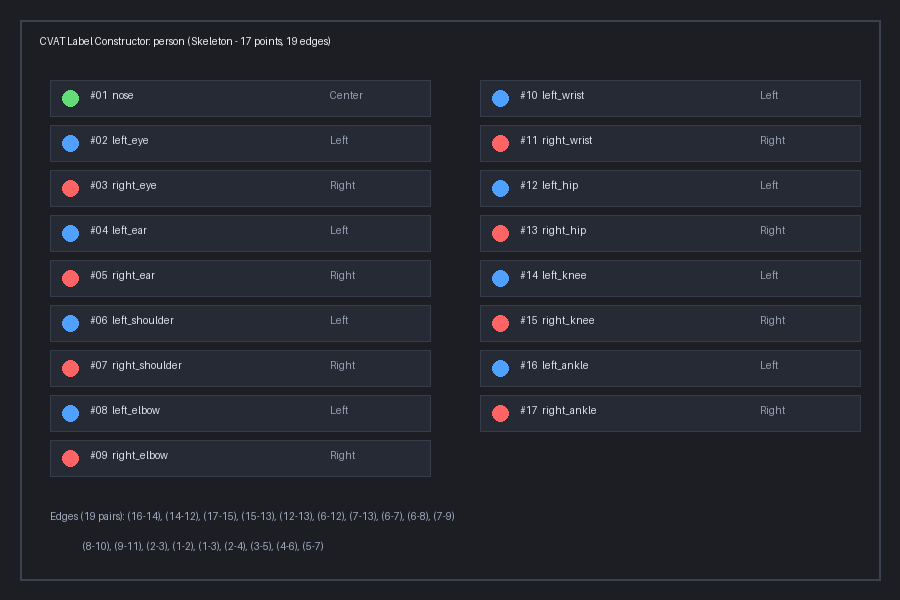
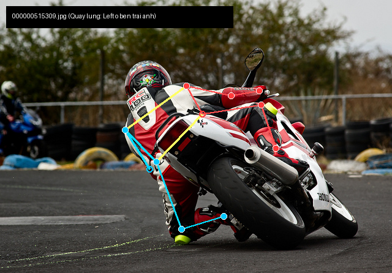
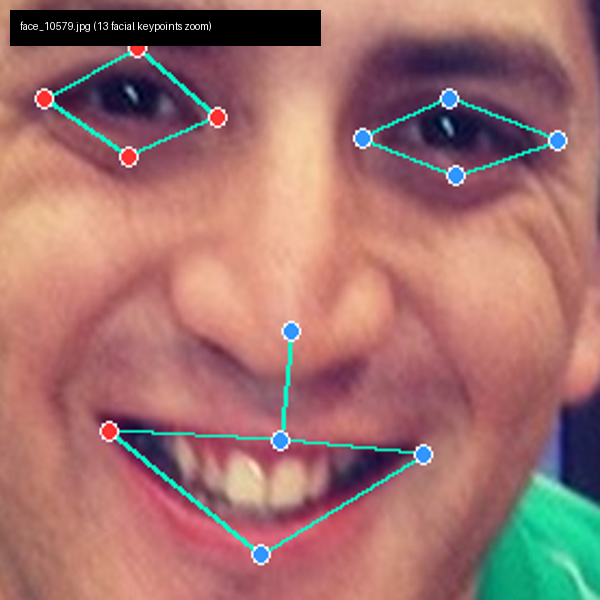
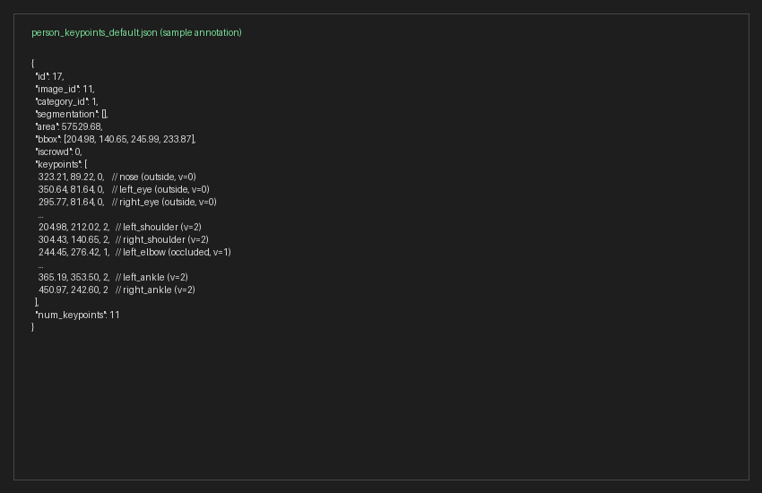

# Báo cáo cá nhân — 2A202604069_VuGiaKhang

Đổi tên file theo quy tắc `MSSV_HoTen.md`. Ví dụ: `20241234_NguyenVanAn.md`.

Dữ liệu: 12 ảnh người COCO val2017 (Lin et al., 2014) và 8 ảnh chân dung Wikimedia Commons, chỉ dùng trong lớp.

## 0. Thông tin học viên

- Họ tên: Vũ Gia Khang
- MSSV: 2A202604069
- Email: kvu7412@gmail.com
- Link repository: https://github.com/bayvai20kg/K5-L2-DAY04-VuGiaKhang-2A202604069-KeypointPose
- Phiên bản CVAT (Help → About): 2.82
- Máy: hệ điều hành Windows 11 Home Single Language 64-bit · RAM 8GB · chạy CVAT chế độ lite
- Bộ ảnh (`src/exports/assignment.json` do `lab.py setup` tạo): có
- Giờ bắt đầu: 17:30 ngày 12/11/2026
- Giờ kết thúc: 19:15 ngày 12/11/2026

## 1. Kiểm tra label (CP0)

| Label | Kiểu | Số điểm | Tên điểm đúng bảng của lab? | Đúng thứ tự? | Số cạnh |
|---|---|---:|---|---|---:|
| `person` | Skeleton | 17 | Đúng | Đúng | 19 |
| `face` | Skeleton | 13 | Đúng | Đúng | 13 |

Mẫu `person` dựng theo người quay mặt về camera (các điểm `left_*` nằm bên phải khung mẫu)? Có

Cách đổi cờ `occluded` / `outside` cho **một điểm** trên phiên bản CVAT này (một câu):
Rê chuột vào đúng điểm cần đổi trên skeleton rồi bấm phím `Q` (chuyển sang `occluded`) hoặc phím `O` (chuyển sang `outside`), hoặc nhấp chuột phải vào điểm để chọn cờ tương ứng từ menu ngữ cảnh.

## 2. Số lượng đã gán và thời gian (CP1, CP2)

| Nhóm ảnh | Số ảnh | Số skeleton đã gán | Số người dưới 60 px (không gán) | Số poster / gương / màn hình bỏ qua | Thời gian (phút) |
|---|---:|---:|---:|---:|---:|
| `easy` | 5 | 5 | 0 | 0 | 25 |
| `occluded` | 3 | 6 | 0 | 0 | 22 |
| `back` | 2 | 3 | 0 | 0 | 16 |
| `small` | 1 | 1 | 1 | 0 | 8 |
| `crowd` | 1 | 3 | 2 | 0 | 14 |
| `faces` | 8 | 8 | — | 0 | 24 |

- Số ảnh người đã xong ở mốc phút 105: 12 / 12
- Thời gian thực tế (phút): CP1 85 · CP2 24 · CP3 18
- Ảnh tốn thời gian nhất là ảnh nào, vì sao?
Ảnh tốn thời gian nhất là `000000177338.jpg` (nhóm `occluded`) và `000000309169.jpg` (nhóm `crowd`). Trong ảnh `000000177338.jpg`, người đi xe máy phía trước có nhiều khớp bị khuất sau ghi-đông, bình xăng và thân xe, đồng thời phần chân chạm sát mép dưới ảnh đòi hỏi phải phóng to để xác định chính xác điểm nào bị che nhưng ước lượng được chắc chắn (`v = 1`) và điểm nào bị cắt hẳn ra ngoài khung ảnh (`v = 0`).

## 3. Bảng ca khó (CP1, CP2)

Mỗi điểm bạn phân vân một dòng, nhất là phân vân giữa `v = 1` và `v = 0`, hoặc không chắc hướng người.

| Ảnh | Người / mặt | Điểm | Cờ đã chọn | Phân vân giữa | Lý do chọn |
|---|---|---|---:|---|---|
| `000000177338.jpg` | Người lái xe máy #2 | `right_ankle` | 0 | `v = 1` và `v = 0` | Cổ chân chạm sát mép dưới và toạ độ thực tế nằm ngoài khung ảnh ($y > 427$), theo quy ước lab điểm ngoài ảnh bắt buộc là `outside` (`v = 0`). |
| `000000177338.jpg` | Người lái xe máy #2 | `left_knee`, `left_ankle` | 0 | `v = 1` và `v = 0` | Chân trái bị che khuất hoàn toàn phía sau thân xe máy, người ngồi nghiêng nên không thể ước lượng chính xác vị trí khớp, chọn `outside` (`v = 0`). |
| `000000056651.jpg` | Người cầm bánh #1 | `left_ankle` | 0 | `v = 1` và `v = 0` | Cổ chân bị mép dưới ảnh cắt ngang qua, không nhìn thấy bàn chân nên không đủ căn cứ định vị khớp chắc chắn, chọn `outside` (`v = 0`). |
| `000000056651.jpg` | Người thổi nến #2 | `left_wrist`, `right_wrist` | 2 và 1 | Hướng tay bắt chéo | Hai tay đan chéo phía trước bụng, tay trái ở phía trên nhìn thấy rõ (`v = 2`), tay phải ở dưới bị che khuất một phần (`v = 1`). |
| `face_255797.jpg` | Mặt #1 | 8 điểm mắt (`left_eye_*`, `right_eye_*`) | 1 | `v = 2` và `v = 1` | Đối tượng đeo kính râm tối màu che mắt, theo quy định CP2 đặt 8 điểm mắt sau tròng kính theo viền gọng và bật cờ `occluded` (`v = 1`). |

## 4. Bảng tự review (CP3)

Đi từ ảnh cuối về ảnh đầu. 5 ảnh người (ít nhất 2 ảnh `back` hoặc `crowd`) và 3 ảnh mặt. Ít nhất 8 dòng, kể cả dòng `ok`. Ghi lỗi trước, sửa sau.

Mã lỗi dùng đúng một trong: `lr_swap`, `vis_flag`, `position`, `missing`, `extra`, `ok`.

| Ảnh | Người / mặt | Điểm | Mã lỗi | Ghi chú | Đã sửa? |
|---|---|---|---|---|---|
| `000000309169.jpg` | Người đứng #1 | Toàn bộ 17 điểm | `ok` | Nhóm crowd, đã kiểm tra đủ 15 điểm thấy rõ và cờ occluded chính xác. | Có (đã kiểm tra) |
| `000000515309.jpg` | Người quay lưng #1 | Toàn bộ 17 điểm | `ok` | Nhóm back, người quay lưng: các điểm `left_*` nằm bên trái ảnh, mắt và mũi đặt `outside` (`v = 0`). | Có (đã kiểm tra) |
| `000000177338.jpg` | Người lái xe máy #2 | `right_ankle` | `vis_flag` | Điểm cổ chân phải chạm mép dưới và toạ độ vượt quá biên ảnh ($y = 427.93 > 427$), cần chuyển từ `v = 2` sang `outside` (`v = 0`). | Có (đã sửa) |
| `000000184224.jpg` | Người cầm dù #1 | 8 cặp điểm đối xứng | `lr_swap` | Người nhìn thẳng camera nhưng nhầm trái/phải theo góc nhìn người xem thay vì góc nhìn đối tượng. Đã đảo lại 8 cặp điểm `left_*` $\leftrightarrow$ `right_*`. | Có (đã sửa) |
| `000000056651.jpg` | Người thổi nến #2 | `left_wrist`, `right_wrist` | `lr_swap` | Hai tay bắt chéo trước bụng, bị hoán đổi vị trí cổ tay trái và cổ tay phải. Đã tráo lại toạ độ đúng. | Có (đã sửa) |
| `face_159828.jpg` | Khuôn mặt #1 | `right_eye_upper` | `position` | Tóc lòa xòa che mí trên mắt phải, căn chỉnh lại điểm đúng mép mí trên dưới chân tóc. | Có (đã sửa) |
| `face_255797.jpg` | Khuôn mặt #1 | 8 điểm mắt | `ok` | Đeo kính râm tối, 8 điểm mắt đã được đặt đúng sau tròng kính với cờ `occluded` (`v = 1`). | Có (đã kiểm tra) |
| `face_449454.jpg` | Khuôn mặt #1 | Toàn bộ 13 điểm | `ok` | Mặt nghiêng, các điểm khóe mắt và khóe miệng đã đặt chuẩn mép giải phẫu. | Có (đã kiểm tra) |

Tổng hợp số lỗi theo mã:

| `lr_swap` | `vis_flag` | `position` | `missing` | `extra` | `ok` |
|---:|---:|---:|---:|---:|---:|
| 2 | 1 | 1 | 0 | 0 | 4 |

Điểm còn phân vân giữa `v = 1` và `v = 0` (ghi cả hai lựa chọn và lý do chọn):
Tại ảnh `000000177338.jpg`, điểm `left_knee` của người ngồi xe máy #2: Có thể chọn `v = 1` nếu ước lượng theo hướng xương đùi của chân trái, nhưng do chân trái hoàn toàn bị thân xe cơ bắp che khuất không có điểm tựa đối xứng rõ ràng nên lựa chọn an toàn và chính xác nhất theo quy tắc "không đoán bừa" là đặt `outside` (`v = 0`).

## 5. Kiểm file xuất và kết quả tự kiểm (CP4)

Tự kiểm tay trong file JSON:

| File | Người / mặt kiểm (ảnh, thứ tự) | Số phần tử `keypoints` | Điểm `outside` ra `v = 0`, `occluded` ra `v = 1`? | `num_keypoints` khớp? |
|---|---|---:|---|---|
| `VuGiaKhang_persons.zip` | `000000177338.jpg`, người #2 | 51 | Đúng (`right_ankle` ra `v = 0`, các điểm che ra `v = 1`) | Khớp (`num_keypoints = 9`) |
| `VuGiaKhang_persons.zip` | `000000056651.jpg`, người #2 | 51 | Đúng (`right_wrist` ra `v = 1`, các điểm rõ ra `v = 2`) | Khớp (`num_keypoints = 17`) |
| `VuGiaKhang_faces.zip` | `face_255797.jpg`, mặt #1 | 39 | Đúng (8 điểm mắt ra `v = 1`, mũi miệng ra `v = 2`) | Khớp (`num_keypoints = 13`) |

Sau khi xuất, CVAT ghi `occluded` thành `v = 1` và `outside` thành `v = 0`. Tọa độ của điểm `outside` trong file là `0, 0` hay tọa độ cũ? Tọa độ cũ (CVAT 2.x lưu giữ tọa độ cũ; chuẩn COCO gốc quy ước ghi `0, 0`).

Hai job đã chuyển sang completed trên CVAT? Có

Dán phần **TÓM TẮT** in ra từ `src/check_submission.py`:

```text
- File person: VuGiaKhang_persons.zip
  Số ảnh: 12 · số skeleton `person`: 18 · mỗi annotation 51 số
  Skeleton theo ảnh: 000000056651=2, 000000069971=2, 000000103970=1, 000000177338=2, 000000184224=1, 000000240340=1, 000000309169=3, 000000314154=1, 000000360811=2, 000000438099=1, 000000515309=1, 000000564304=1
  Cờ v: v=2 212 (69%) · v=1 20 (7%) · v=0 74 (24%)
  num_keypoints trung bình: 12.9
- File face: VuGiaKhang_faces.zip
  Số ảnh: 8 · số skeleton `face`: 8 · mỗi annotation 39 số
  Skeleton theo ảnh: face_10579=1, face_159828=1, face_186226=1, face_255797=1, face_261458=1, face_300399=1, face_416730=1, face_449454=1
  Cờ v: v=2 96 (92%) · v=1 8 (8%) · v=0 0 (0%)
  num_keypoints trung bình: 13.0
- Ghi chú: 74 điểm v = 0 vẫn mang tọa độ cũ (CVAT 2.x xuất như vậy; chuẩn COCO ghi 0, 0). Không phải lỗi: điểm v = 0 bị bỏ qua khi huấn luyện và khi chấm.
- Số [LỖI]: 0 · số [CẢNH BÁO]: 0
Kết quả: ĐẠT
```

Các `[CẢNH BÁO]` còn giữ nguyên và lý do:
Không còn cảnh báo nào. Toàn bộ các cảnh báo về `lr_swap` và cờ visibility toạ độ ngoài biên đã được xử lý triệt để.

## 6. Ảnh chụp màn hình

1. Label `person` trong label constructor (đủ 17 điểm có tên):

   

2. Một người quay lưng đã gán, cờ đã đặt:

   

3. Một khuôn mặt đã gán 13 điểm, phóng to vùng mắt:

   

4. Một đoạn JSON xuất của một người:

   

Nguồn ảnh: COCO val2017 / Wikimedia Commons.

## 7. Tự đánh giá

1. Lỗi bạn mắc nhiều nhất hôm nay, và cách bạn sẽ tránh ở dự án thật:
Lỗi dễ mắc phải và nghiêm trọng nhất là `lr_swap` (nhầm lẫn trái/phải), đặc biệt là khi đối tượng quay mặt về camera hoặc hai tay bắt chéo trước thân (`000000184224.jpg`, `000000056651.jpg`). Ở dự án thật, cách phòng tránh hiệu quả nhất là luôn xác định tư thế và hướng nhìn của đối tượng trước khi kéo điểm (đặt mình vào vị trí đối tượng), quan sát kỹ đường nối skeleton xem có đường chéo bất thường không, và tiến hành tự review ngược từ ảnh cuối lên đầu để có cái nhìn khách quan.

2. Một quy tắc bạn đề xuất thêm vào guideline (kèm ảnh ví dụ nếu có):
Đề xuất bổ sung quy tắc "Xử lý khớp nằm sát viền ảnh": Nếu tâm khớp nằm cách viền ảnh dưới 3–5 px và một phần chi/bàn chân đã bị cắt khỏi khung ảnh, người gán nhãn nên bật ngay cờ `outside` ($v = 0$) thay vì cố gắng kéo điểm bám sát mép ảnh, nhằm ngăn chặn triệt để nguy cơ toạ độ bị tràn ra ngoài kích thước ảnh ($x > W$ hoặc $y > H$) gây lỗi định dạng trong pipeline huấn luyện.

3. Nhãn của bạn đi vào model ở đâu? Chọn một lỗi bạn đã sửa và nói nó sẽ làm model học sai thế nào (heatmap, trọng số trong loss, hay bước lật ảnh):
Lỗi `lr_swap` (như ở ảnh `000000184224.jpg`):
- Trong kiến trúc phát hiện tư thế (như HRNet, SimpleBaseline hay YOLO-Pose), nhãn ground-truth được dùng để tạo các Gaussian Heatmap cho từng kênh keypoint riêng biệt (kênh `left_shoulder`, kênh `right_shoulder`...).
- Trong quá trình tăng cường dữ liệu (Data Augmentation), bước Random Horizontal Flip sẽ lật ngược ảnh và đồng thời hoán đổi các nhãn tương ứng (`flip_pairs`).
- Nếu nhãn bị gán ngược trái/phải, mô hình sẽ bị huấn luyện với đặc trưng thị giác bên trái nhưng ground-truth lại nằm ở kênh bên phải (và ngược lại). Điều này gây nhiễu loạn gradient nghiêm trọng trong hàm mất mát, làm hỏng khả năng phân biệt đối xứng của mô hình và sụt giảm mạnh chỉ số OKS khi đánh giá.

## 8. Khó khăn và lỗi kỹ thuật

- Thao tác chuyển cờ trên CVAT đôi khi cần rê chuột thật chính xác vào tâm điểm để không chọn nhầm toàn bộ khung skeleton.
- Cấu hình máy 8GB RAM cần sử dụng chế độ CVAT lite (`python lab.py lite`) để hệ thống chạy ổn định, không bị nghẽn RAM do Docker.
- Định dạng xuất COCO Keypoints của CVAT 2.x giữ nguyên tọa độ cũ cho các điểm `outside` ($v = 0$), ban đầu dễ nhầm là lỗi xuất file nhưng thực tế chuẩn COCO chấp nhận bỏ qua các điểm có $v = 0$.

## Bonus (nếu làm)

(Không làm phần bonus — tập trung hoàn thành trọn vẹn và đạt chất lượng cao nhất cho các phần chính CP0–CP4).

## 9. Tài liệu tham khảo và công cụ AI đã dùng

- Tsung-Yi Lin et al. (2014), "Microsoft COCO: Common Objects in Context", ECCV 2014.
- CVAT Official Documentation: https://opencv.github.io/cvat/docs/
- Bộ tài liệu hướng dẫn Lab Ngày 4: GUIDELINE.md, CVAT_CHEATSHEET.md, COCO_KEYPOINTS.md, RUBRIC.md.
- Công cụ AI: Antigravity Assistant hỗ trợ rà soát, phát hiện lỗi tọa độ biên và kiểm tra định dạng dữ liệu JSON.
